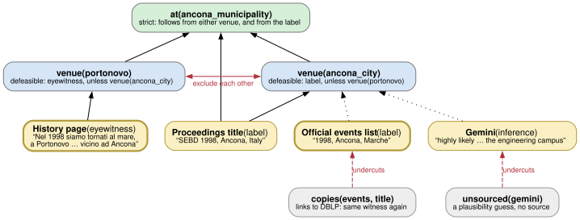

#+TITLE: Where was SEBD 1998? An unresolved fact, as rules
#+UPDATED: 2026-10-20 Tue 14:55 CDT
#+SUBTITLE: Last updated {{{keyword(UPDATED)}}}
#+AGENT: Claude Code — Opus 5.5, model id claude-opus-5-5 (with Bertram Ludäscher)

* The question
The tour's input table, like DBLP and the official events list, places the 6th SEBD
(1998) in *Ancona*. The symposium's own history page, written by a participant, says
the meeting "went back to the sea, to Portonovo … near Ancona". Portonovo also hosted
the 14th SEBD (2006). If 1998 was in Portonovo too, editions 6 and 14 are a fourth
twin pair, and the tour's input changes. As of 2026-10-20 this is unresolved.

* Files
| File            | What it is                                                         |
|-----------------+--------------------------------------------------------------------|
| [[file:venue1998.lp][venue1998.lp]]  | the model: strict facts, defeasible rules, undercutters (clingo)   |
| [[file:venue1998.gv][venue1998.gv]]  | a diagram drawn /from/ the rules (a view, not a translation)       |
|  | the rendered diagram                                               |
| [[file:runs-2026-10-20.txt][runs-2026-10-20.txt]] | every solver run on this page, verbatim (all, cautious, brave, four what-ifs) |

* Why rules, not an argumentation framework
The sources, the reasons to discount some of them, and the defeasible step from
"a source says X" to "X" are written as a logic program with default negation. Its
stable models are the readings of the evidence; what holds in all of them is what
the evidence establishes. Translating this into an abstract (or bipolar)
argumentation framework first would discard the rule structure that explains
/why/ an argument wins or loses (cf. Bowers & Ludäscher, "Lost in Translation",
COMMA 2026). The diagram is therefore drawn from the rules, node by rule.

* Known, assumed, and what follows
- *Known* (strict facts): what each source says; that the events list repeats DBLP and
  that Gemini cites no source; that Portonovo lies within the comune of Ancona.
- *Assumed* (an explicit choice, both options open): what "Ancona" on the title page
  refers to — the city where the meeting was held (a common convention for
  proceedings), or only the comune / area, which includes Portonovo.
- *Defeasible*: a reliable source saying X supports X, unless the conflicting venue holds.

An earlier version of these rules (2026-10-20, never published) stated as a known fact
that "Ancona" names the comune, while also letting the same label support "the city
proper". That hid the assumption inside the rules. A review note caught it; the
assumption is now explicit, and every reading reports which option it takes.

* What the solver says (clingo 5.6.2, 2026-10-20)
: clingo venue1998.lp -n 0

#+begin_example
Answer: 1
at(ancona_municipality) undercut(events) undercut(gemini) witness(history) witness(title) venue(portonovo) at(portonovo) label_means(municipality)
Answer: 2
at(ancona_municipality) undercut(events) undercut(gemini) witness(history) witness(title) venue(ancona_city) label_means(city) at(ancona_city)
Answer: 3
at(ancona_municipality) undercut(events) undercut(gemini) witness(history) witness(title) venue(portonovo) label_means(city) at(portonovo)
SATISFIABLE
#+end_example

| Reading | Assumption about the label | Venue                        |
|---------+----------------------------+------------------------------|
| 1       | names only the comune      | Portonovo                    |
| 2       | names the city             | Ancona city (label wins)     |
| 3       | names the city             | Portonovo (eyewitness wins)  |

In every reading (=--enum-mode=cautious=):

#+begin_example
at(ancona_municipality) undercut(events) undercut(gemini) witness(history) witness(title)
#+end_example

So: the meeting was *within the comune of Ancona* (known); the events list and Gemini
carry no independent weight (known). *Portonovo* is a possible answer under either
assumption. *Ancona city* is possible only if the label names the city /and/ it is
preferred over the eyewitness. Which venue it was is not established.

* What would settle it
Add one line (or pipe it in, e.g. =echo "organizer_says(portonovo)." | clingo venue1998.lp - -n 0=):

| Added                            | Venue in every reading |
|----------------------------------+------------------------|
| =organizer_says(portonovo).=     | Portonovo              |
| =organizer_says(ancona_city).=   | Ancona city            |
| =:- label_means(city).=          | Portonovo              |
| =:- label_means(municipality).=  | still open (readings 2 and 3) |

The first two are evidence: ask a 1998 organizer (Paolo Atzeni, Luca Cabibbo, Maurizio
Panti) or find the printed proceedings. The last two only fix the assumption; note that
even reading the label as the city leaves the question open, because the eyewitness
still disagrees.

* What it means for the tour
Nothing yet: the tour keeps 1998 at Ancona's coordinates, as in DBLP. Under the
Portonovo reading, edition 6 would move about 9 km and become a twin of edition 14;
the optimum would have to be re-solved and re-certified. That has not been done.
